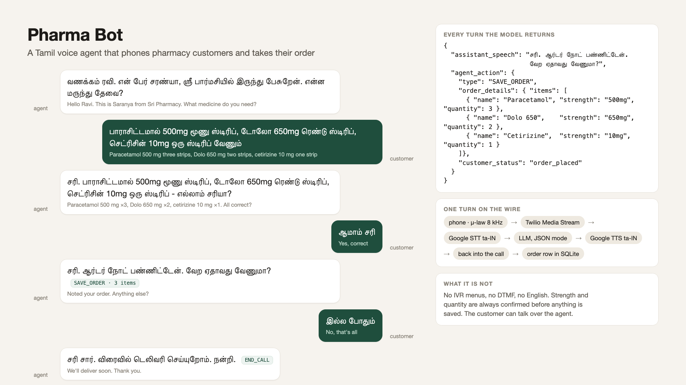
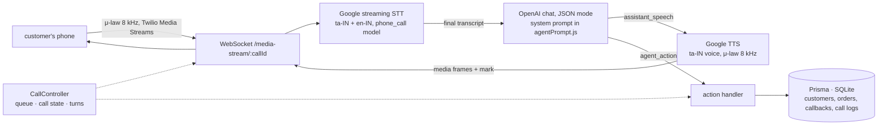

# Pharma Bot — a Tamil voice agent that phones pharmacy customers and takes their order

[](https://github.com/dakshinsiva/pharma-bot/actions/workflows/ci.yml)


Give it a list of customers and it rings each one, greets them in Tamil, asks what medicines they
need, confirms strength and quantity, and writes the result to a database as an order or a callback.
Speech comes in over the carrier's media stream, is transcribed as it is spoken, goes through a
language model that must answer in Tamil *and* emit a machine-readable action, and goes back out as
synthesised Tamil speech into the same call. No IVR menus, no "press 1", no English, and no human
listening in: the agent's own decisions are what get saved.



*Left, the call script as the system prompt specifies it (this is the prompt's own worked example,
with English glosses): greet, take every medicine the customer names in one breath, confirm all of them
together, save, close. Right, the object the model returns on every turn, the path one turn takes, and
what the agent deliberately is not.*

The use case is a neighbourhood pharmacy in Tamil Nadu that phones its regular customers to take
repeat orders. Those calls are short, formulaic and in Tamil with English brand names mixed in ("Dolo
650", "Crocin"), which makes them a good fit for an agent and a bad fit for a menu-driven IVR.

## Why this is hard

A phone call arrives as 8 kHz μ-law, a format designed in the 1970s to squeeze a voice down a copper
pair. Tamil speech recognition is already weaker than English, and the words that matter most, the
medicine names, are English brand names spoken inside Tamil sentences, so the recogniser has to
code-switch in the middle of an utterance. The model on the other end cannot simply chat: every reply
has to carry a decision the server can execute without anyone reading it, which rules out free text.
Each turn costs about two seconds of streaming recognition, model inference and synthesis, so a
conversation that asks about one medicine at a time is slow and, across many medicines, expensive;
the shape of the conversation is as much a part of the system as the code. And the carrier does not
tell you when audio can actually flow: the "answered" callback and the media stream's own start frame
arrive over different connections in either order, and if the greeting goes out before the stream is
open it is lost. On top of that, outbound calling to Indian numbers is regulated, which shaped how the
telephony layer could be built and tested (see *Limitations*).

The pipeline deals with each of those explicitly, and the two things it never leaves to the model are
whether the reply parsed and whether the customer has finished hearing it.

## Pipeline



| Stage | What happens | Output |
|---|---|---|
| **Dial** | A queue of customers is dialled one at a time with a configurable gap. Each call gets a UUID and a call-log row, then a carrier SID. Twilio and Exotel sit behind one event interface (`callInitiated`, `callAnswered`, `callCompleted`, `callFailed`); answering machines are hung up on. | `call_logs` row, provider events |
| **Connect** | Twilio executes `<Connect><Stream>` and opens a WebSocket to `/media-stream/:callId`. The upgrade is routed by call id; the conversation starts on the stream's `start` frame, not on the status callback. | one `TwilioMediaStream` per live call |
| **Listen** | Inbound base64 μ-law frames are decoded and written straight into a Google streaming-recognition session configured for Tamil with an English alternative and the `phone_call` model. Only final results are acted on; the stream restarts itself on recoverable errors. | final transcripts with confidence |
| **Decide** | The transcript joins the call's history and goes to the model with `response_format: json_object`. The reply must match `{assistant_speech, agent_action}`; it is validated and replaced by a Tamil "could you repeat that?" if it does not. Turns are serialised per call. | one validated action per turn |
| **Act** | `SAVE_ORDER` writes the items; `SAVE_CALLBACK` parses the requested time; `END_CALL` updates the customer's status and hangs up. Medicine names are normalised from Tamil to English with a dictionary plus Levenshtein matching, and each item carries a confidence score. | `orders`, `callbacks`, customer status |
| **Speak** | The Tamil reply is synthesised in the carrier's own format (μ-law, 8 kHz), the WAV header is stripped, and the samples go back into the stream in 200 ms frames followed by a `mark`. The turn continues only when Twilio reports the mark, so the customer has heard the whole reply before the agent acts on it or hangs up. If the customer speaks over the agent, a `clear` flushes what has not played. | audio in the call, playback confirmation |
| **Record** | At hang-up the call log gets the full transcript, the list of actions taken, the duration and the final carrier status. | `call_logs` row completed |

## The action contract

The model never gets to reply in free text. Every turn is this object, with the speech in Tamil and the
action in English:

```json
{
  "assistant_speech": "சரி. பாராசிட்டமால் 500mg ரெண்டு ஸ்டிரிப் சரியா? வேற ஏதாவது வேணுமா?",
  "agent_action": {
    "type": "SAVE_ORDER",
    "order_details": { "items": [{ "name": "Paracetamol", "strength": "500mg", "quantity": 2 }], "notes": "" },
    "callback_time": "",
    "customer_status": "order_placed"
  }
}
```

There are six action types: `NONE`, `SAVE_ORDER`, `SAVE_CALLBACK`, `NOT_AVAILABLE`, `END_CALL` and
`NEXT_CUSTOMER`. The system prompt (`src/llm/agentPrompt.js`) encodes the call script as rules and
few-shot examples: greet, ask what is needed, extract every medicine the customer names in one
breath, always confirm both strength and quantity before saving, never re-ask for something already
given, offer a callback when a medicine is out of stock, and only end the call when the customer says
they are done. The controller switches on the action type, and both the type list and the fallback are
covered by unit tests so the prompt and the controller cannot drift apart.

The first version of the script was a natural back-and-forth: one medicine, then its quantity, then
"anything else?". Measured against what a pharmacist does on the phone it was slow. At roughly two
seconds a turn, five medicines took around twenty turns and forty seconds, with token cost growing
quadratically as the history was re-sent each turn. Two designs are kept:

| | Conversational | Order taker |
|---|---|---|
| Who leads | Agent asks one thing at a time | Customer lists everything, agent confirms once |
| Turns for 3 medicines | ~12 before batching, 4–5 after | 3–4 |
| Best for | First-time or hesitant customers | Regular customers who know what they want |
| Endpoint and UI | `/api/llm`, `public/voice-test.html` | `/api/order-taker`, `public/order-taker.html` |

The conversational prompt was then rewritten to batch: if the customer names three medicines with
quantities in one sentence, the agent confirms all three in one reply and saves one order. The
analysis behind the change is in [docs/CONVERSATION_VS_ORDER_TAKER.md](docs/CONVERSATION_VS_ORDER_TAKER.md).

## What comes out

Three kinds of record, all keyed to a customer, all written during the call rather than after it:

| Record | Written when | Holds |
|---|---|---|
| `orders` | The model emits `SAVE_ORDER` after the customer confirms | items as `[{name, strength, quantity, notes}]`, notes, status `pending` |
| `callbacks` | The model emits `SAVE_CALLBACK` | requested time (parsed from "tomorrow", "evening" or ISO), reason, status `scheduled` |
| `call_logs` | Created at dial, completed at hang-up | carrier SID and final status, duration, the full `Agent: … / Customer: …` transcript, every action taken, as JSON |

Every call also updates the customer's status (`contacted`, `order_placed`, `callback_scheduled`,
`not_interested`), which is what the queue uses to decide who to ring next. The same data is available
over the API: `/api/customers/:id/orders`, `/callbacks`, `/call-logs`, and `/api/llm/transcript/:callId`
while a call is live.

Items go through the extractor before they are trusted. `பாராசிட்டமால்`, `பாரா` and `paracetamol` all
normalise to `Paracetamol`; `மூணு ஸ்டிரிப்` to three strips; `டோலோ 650` to a strength of 650 mg. An
item the dictionary does not know is kept with a low confidence and the reason attached, so a person
reviewing orders can see which lines the agent was unsure about rather than having them silently
dropped.

## Running it

You need Node 18+, an OpenAI key, and a Google Cloud service account with Speech-to-Text and
Text-to-Speech enabled. A telephony account is only needed for real phone calls.

```bash
npm install
cp .env.example .env            # fill in OPENAI_API_KEY and GOOGLE_APPLICATION_CREDENTIALS
npm run db:generate && npm run db:push
npm start
```

**Talk to the agent from a browser**, with no telephony account: open
http://localhost:3000/voice-test.html in Chrome, allow the microphone, and speak Tamil. The page uses
the browser's speech recognition for input, the server for the reply, and plays back the Google TTS
audio. `order-taker.html` is the same for the one-shot mode. Two terminal scripts run the full Google
STT → LLM → TTS loop from the microphone instead:

```bash
npm run voice-realtime          # live microphone loop (macOS, no extra tools)
npm run voice-file -- clip.wav  # transcribe a recording, get a spoken reply
```

**Make real calls**: set `ACTIVE_TELEPHONY_PROVIDER`, the matching credentials and a public `BASE_URL`
(`scripts/setup-ngrok.sh` starts a tunnel and writes it to `.env`), then:

```bash
npm run seed                                   # ten sample customers
node scripts/make-call.js +91XXXXXXXXXX        # one call
npm run call                                   # dial every customer with status "pending"
```

Exotel needs a Flow pointing at this server; the steps are in [docs/EXOTEL_SETUP.md](docs/EXOTEL_SETUP.md).
`npm test` runs the unit tests (prompt contract, extractor, Media Stream protocol, WebSocket routing);
they need no network or credentials and run in CI. `npm run test:system` exercises the HTTP API against
a running server.

## Design notes

- **Structured output as the integration boundary.** JSON mode plus a validator means a bad model reply
  degrades to a polite "please repeat", never to a corrupted order. The action types live in one place
  and the controller switches on them.
- **Provider abstraction at the event level, not the API level.** Twilio and Exotel differ in how calls
  are placed (REST with inline TwiML vs. a connect API plus a Flow), how status arrives (JSON vs.
  multipart), and whether media streaming exists at all. Both reduce to the same handful of events, and
  the controller never sees provider fields.
- **The conversation starts when audio can flow.** The greeting is triggered by the media stream's
  `start` frame, not the carrier's "answered" callback. The recogniser is started before the greeting
  so nothing the customer says early is lost, and turns are serialised per call so two quick
  utterances cannot race each other to the model.
- **Playback is confirmed, not assumed.** Each reply ends with a `mark`; the turn resolves when Twilio
  echoes it back, with a timeout of the clip's duration plus a grace period. That is what lets
  `END_CALL` hang up after the goodbye rather than during it.
- **Audio formats chosen per channel.** STT and TTS run in the carrier's native μ-law 8 kHz so nothing
  is transcoded on the call path; the browser path uses 24 kHz PCM because it can. The WAV header
  Google wraps around μ-law is removed by walking the RIFF chunks rather than skipping a fixed 44 bytes,
  which turned out to matter (see *Validation*).
- **In-memory call state, durable outcomes.** Active calls and conversation history live in maps for
  speed during the call; orders, callbacks and call logs go to the database as they happen, and the
  transcript is written at hang-up. Stale sessions are swept every thirty minutes.
- **Confidence instead of rejection.** The extractor normalises what it recognises and passes through
  what it does not, scored, so review is possible and nothing is lost.

## Validation

- Protocol: 23 unit tests drive the Media Stream handler with recorded Twilio frames (`start`,
  `media`, `mark`, `clear`) and a real WebSocket client against the upgrade router, and check the
  prompt's action types against the controller's and the extractor's Tamil-to-English mappings.
- Google TTS, `ta-IN-Standard-A` at μ-law 8 kHz, measured on 9 October 2026: a 4.5 s reply synthesised
  in 481 ms on the first call and 101–298 ms on the next three; the 6.4 s greeting in 773 ms. Google's
  μ-law output carries a 58-byte RIFF header, not the 44 bytes a fixed skip would assume, so the chunk
  walker is required.
- Degradation: in the same run the OpenAI account was out of credit and every model request failed.
  All four turns produced the Tamil fallback with a `NONE` action and the session stayed consistent,
  which is the behaviour the validator is there to guarantee.
- Not measured: model latency on a funded account, and anything over a real phone line (below).

## Repository layout

```
server.js, app.js        HTTP + WebSocket entry point and Express routes
src/telephony/           CallController (queue, state, turns), Twilio and Exotel adapters,
                         Media Stream upgrade router and per-call stream protocol
src/stt/                 Google streaming speech-to-text for Tamil phone audio
src/tts/                 Google Tamil text-to-speech in telephony and browser formats
src/llm/                 Conversational and order-taker prompts and their session handlers
src/utils/               Medicine-name normalisation, quantity and strength extraction, confidence
src/routes/              /api/calls, /api/customers, /api/llm, /api/order-taker, /api/tts, /api/telephony
prisma/                  Schema: customers, orders, callbacks, call logs (SQLite in development)
public/                  Browser demos for both conversation modes
scripts/                 Seeding, dialling, microphone test loops, Exotel diagnostics, ngrok setup
test/                    Prompt contract, extractor, Media Stream protocol, WebSocket routing
docs/                    Architecture, call flow, audio pipeline, prompt, deployment, Exotel setup
docs/images/             The cover above
```

## Limitations

The phone loop has been exercised against Twilio's protocol, not against a real customer on a real
line: development hit Twilio's do-not-originate restriction on Indian caller IDs and Exotel's KYC gate,
so the per-turn latency figures are component estimates and the end-to-end feel of a call is untested.
Exotel has no media streaming on the plan this was built for, so with that provider the agent's
replies are logged but not spoken; hosting each clip for `<Play>` or using Exotel's `<Say>` would close
that gap. There is no stock lookup: "available" and "not available" are the model's judgement from
the prompt, not a query against inventory, which a real deployment would need before the agent can
promise anything. Callback times are parsed with a handful of rules ("tomorrow", "evening", ISO), the
medicine dictionary covers a dozen common names, Google's streaming recognition caps a single stream
at about five minutes, conversation state is per-process, the database is SQLite, and the API has no
authentication. All of that is acceptable for an MVP and none of it for production;
[docs/DEPLOYMENT.md](docs/DEPLOYMENT.md) covers what would change.

## Licence

MIT.
