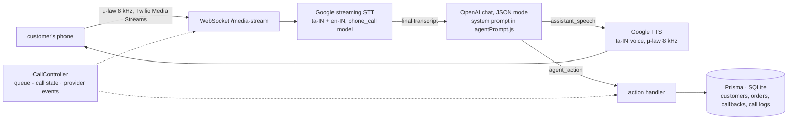

# Pharma Bot — a Tamil voice agent that phones pharmacy customers and takes their order

[](https://github.com/dakshinsiva/pharma-bot/actions/workflows/ci.yml)


Give it a list of customers and it rings each one, greets them in Tamil, asks what medicines they
need, confirms strength and quantity, and writes the result to a database as an order or a callback.
Speech comes in over a telephony media stream, is transcribed as it is spoken, goes through an LLM
that must answer in Tamil *and* emit a machine-readable action, and goes back out as synthesised Tamil
speech. The same agent can be driven from a browser with a microphone, which is how most of the
development was done.

The use case is a neighbourhood pharmacy in Tamil Nadu that phones its regular customers to take repeat
orders. Those calls are short, formulaic and in Tamil with English brand names mixed in ("Dolo 650",
"Crocin"), which makes them a good fit for an agent and a bad fit for a menu-driven IVR.

## Why this is hard

- **Telephony audio is poor.** Phone calls arrive as 8 kHz μ-law. Tamil speech recognition is already
  weaker than English, and medicine names are English brand names spoken inside Tamil sentences, so the
  recogniser has to code-switch mid-utterance.
- **The agent has to act, not just chat.** Every reply must carry a structured decision (save an order,
  schedule a callback, mark a medicine unavailable, end the call) that the server can execute without a
  human in the loop. A free-text LLM reply is useless here.
- **Every turn costs about two seconds.** Streaming STT, an LLM call and TTS each add latency. A
  conversation that asks about one medicine at a time is slow and, over many medicines, expensive. The
  conversation design is as much a part of the system as the code.
- **Indian outbound calling is regulated.** Caller IDs on Indian numbers are restricted on Twilio trial
  accounts and Exotel requires KYC before outbound calls, which shaped how the telephony layer was built
  and tested (see *Status*).

## Pipeline



| Stage | What happens | Where |
|---|---|---|
| **Dial** | A queue of customers is dialled one at a time with a configurable gap. Each call gets a UUID, a call-log row, and a provider SID once the carrier accepts it. Twilio and Exotel are interchangeable behind one event interface (`callInitiated`, `callAnswered`, `callCompleted`, `callFailed`). | `src/telephony/callController.js`, `twilioOutbound.js`, `exotelOutbound.js` |
| **Listen** | Twilio opens a bidirectional Media Stream to the server on `/media-stream/:callId`; inbound base64 μ-law frames are decoded and written straight into a Google streaming-recognition session configured for Tamil with an English alternative and the `phone_call` model. Only final results are acted on; the stream restarts itself on recoverable errors. | `src/telephony/mediaStreamServer.js`, `twilioMediaStream.js`, `src/stt/googleStreamSTT.js` |
| **Decide** | The transcript is appended to the call's history and sent to the model with `response_format: json_object`. The reply must match `{assistant_speech, agent_action}`; it is validated and replaced by a Tamil "could you repeat that?" fallback if it does not. | `src/llm/processLLM.js`, `src/llm/agentPrompt.js` |
| **Act** | `SAVE_ORDER` writes the items; `SAVE_CALLBACK` parses the requested time; `END_CALL` updates the customer's status and hangs up. Medicine names are normalised from Tamil to English with a dictionary plus Levenshtein matching, and each item gets a confidence score. | `callController.handleAction`, `src/utils/medicineExtractor.js` |
| **Speak** | The Tamil reply is synthesised with a Google `ta-IN` voice directly in the telephony format (μ-law, 8 kHz), the WAV header is stripped, and the samples are written back into the same Media Stream in 200 ms frames followed by a `mark`. The turn only continues once Twilio reports the mark, so the customer has heard the whole reply before the agent acts on it or hangs up. If the customer speaks over the agent, a `clear` flushes the unplayed audio. | `src/tts/tamilTTS.js`, `src/telephony/twilioMediaStream.js` |
| **Record** | Every call ends with its transcript, the list of actions taken, duration and final carrier status stored on the call log. | `prisma/schema.prisma` |

## The agent's contract

The model never gets to reply in free text. Every turn is this object, with the speech in Tamil and the
action in English:

```json
{
  "assistant_speech": "சரி. பாராசிட்டமால் 500mg ரெண்டு ஸ்டிரிப் சரியா? வேற ஏதாவது வேணுமா?",
  "agent_action": {
    "type": "SAVE_ORDER",
    "order_details": { "items": [{ "name": "Paracetamol", "strength": "500mg", "quantity": 2 }], "notes": "" },
    "callback_time": "",
    "customer_status": "order_placed"
  }
}
```

The system prompt (`src/llm/agentPrompt.js`) encodes the call script as rules and few-shot examples:
greet, ask what is needed, extract every medicine the customer names in one breath, always confirm both
strength and quantity before saving, never re-ask for something already given, offer a callback when a
medicine is out of stock, and only end the call when the customer says they are done. The six action
types and the fallback are covered by unit tests so the prompt and the controller cannot drift apart.

## Two conversation designs

The first design was a natural back-and-forth: one medicine, then its quantity, then "anything else?".
Measured against what a pharmacist does on the phone it was slow. At roughly two seconds a turn
(streaming STT 0.5–0.8 s, LLM 1–1.5 s, TTS 0.3–0.5 s), five medicines took around twenty turns and
forty seconds, with token cost growing quadratically as the history was re-sent each turn.

| | Conversational | Order taker |
|---|---|---|
| Who leads | Agent asks one thing at a time | Customer lists everything, agent confirms once |
| Turns for 3 medicines | ~12 | 3–4 |
| Approximate API cost per call | 4× the order-taker | baseline |
| Best for | First-time or hesitant customers | Regular customers who know what they want |
| Endpoint and UI | `/api/llm`, `public/voice-test.html` | `/api/order-taker`, `public/order-taker.html` |

Both modes are kept. The conversational prompt was later rewritten to batch: if the customer names three
medicines with quantities in one sentence, the agent confirms all three in one reply and saves one
order. The analysis behind the switch is in
[docs/CONVERSATION_VS_ORDER_TAKER.md](docs/CONVERSATION_VS_ORDER_TAKER.md).

## Running it

You need Node 18+, an OpenAI key, and a Google Cloud service account with Speech-to-Text and
Text-to-Speech enabled. A telephony account is only needed for real phone calls.

```bash
npm install
cp .env.example .env            # fill in OPENAI_API_KEY and GOOGLE_APPLICATION_CREDENTIALS
npm run db:generate && npm run db:push
npm start
```

**Talk to the agent from a browser** (no telephony account needed): open
http://localhost:3000/voice-test.html in Chrome, allow the microphone, and speak Tamil. The page uses the
browser's speech recognition for input, the server's LLM for the reply, and plays back the Google TTS
audio. `order-taker.html` is the same for the one-shot mode. There are also terminal scripts that record
from the microphone and run the full Google STT → LLM → TTS loop:

```bash
npm run voice-realtime          # live microphone loop (macOS, no extra tools)
npm run voice-file -- clip.wav  # transcribe a recording, get a spoken reply
```

**Make real calls**: set `ACTIVE_TELEPHONY_PROVIDER`, the matching credentials and a public `BASE_URL`
(`scripts/setup-ngrok.sh` starts a tunnel and writes it to `.env`), then:

```bash
npm run seed                                   # ten sample customers
node scripts/make-call.js +91XXXXXXXXXX        # one call
npm run call                                   # dial every customer with status "pending"
```

Exotel needs a Flow pointing at this server; the steps are in [docs/EXOTEL_SETUP.md](docs/EXOTEL_SETUP.md).

**Tests**: `npm test` runs the unit tests for the prompt contract, the medicine extractor, the Twilio
Media Stream protocol and the WebSocket routing. They need no network or credentials and run in CI. `npm run test:system` exercises the HTTP API against a running
server.

## Design notes

- **Structured output as the integration boundary.** JSON mode plus a validator means a bad model reply
  degrades to a polite "please repeat", never to a corrupted order. The list of action types lives in one
  place and the controller switches on it.
- **Provider abstraction at the event level, not the API level.** Twilio and Exotel differ in how calls
  are placed (REST with inline TwiML vs. connect API plus a Flow), how status arrives (JSON vs.
  multipart), and whether media streaming exists at all. Both are reduced to the same handful of events,
  and the controller never sees provider fields.
- **Audio formats chosen per channel.** STT and TTS are configured in the carrier's native μ-law 8 kHz
  so no transcoding happens on the call path; the browser path uses 24 kHz PCM because it can.
- **The conversation starts when audio can flow, not when the carrier says "answered".** Twilio's
  status callback and the Media Stream's `start` frame arrive over different connections in either
  order, so the greeting is triggered by the stream opening. Turns are serialised per call, and the
  speech recogniser is started before the greeting so nothing the customer says early is lost.
- **In-memory call state, durable outcomes.** Active calls and conversation history live in maps for
  speed during the call; orders, callbacks and call logs go to the database as they happen, and the
  transcript is written at hang-up. Stale sessions are swept every thirty minutes.
- **Confidence instead of rejection.** The extractor normalises what it recognises and passes through
  what it does not with a low confidence score and the issues attached, so a human reviewing orders can
  see which items the model was unsure about.

## Status

What works end to end today:

- The browser demos and the microphone scripts: Tamil speech in, Tamil speech out, with orders and
  callbacks landing in the database.
- The REST API, call queue, provider webhooks, and call logging.
- The full Twilio phone path: dial, bidirectional Media Stream, customer audio into Google streaming
  STT, synthesised Tamil back into the call with playback confirmation and barge-in, answering-machine
  hang-up. The stream protocol handling is covered by tests that drive it with recorded Twilio frames
  and a real WebSocket client.

What is not finished:

- **Exotel audio.** Exotel has no media streaming on the plan this was built for, so with that provider
  the agent's replies are logged but not spoken. The options are hosting each clip and using `<Play>`,
  or Exotel's own `<Say>`.
- **Live-call validation over the PSTN.** Development hit Twilio's do-not-originate restriction on Indian
  caller IDs and Exotel's KYC gate, so the loop has been exercised against Twilio's protocol rather than
  a real customer on a real line. The latency figures above are per-component estimates.
- Conversation state is per-process, the database is SQLite, and the API has no authentication. All
  three are fine for an MVP and wrong for production; [docs/DEPLOYMENT.md](docs/DEPLOYMENT.md) covers
  what would change.

## Repository layout

```
server.js, app.js        HTTP + WebSocket entry point, Express routes, Twilio media-stream handler
src/telephony/           CallController (queue, state, turns), Twilio and Exotel adapters, Media Stream server and protocol
src/stt/                 Google streaming speech-to-text for Tamil phone audio
src/tts/                 Google Tamil text-to-speech in telephony and browser formats
src/llm/                 Conversational and order-taker prompts and their session handlers
src/utils/               Medicine-name normalisation, quantity and strength extraction, confidence
src/routes/              /api/calls, /api/customers, /api/llm, /api/order-taker, /api/tts, /api/telephony
prisma/                  Schema: customers, orders, callbacks, call logs (SQLite in development)
public/                  Browser demos for both conversation modes
scripts/                 Seeding, dialling, microphone test loops, Exotel diagnostics, ngrok setup
test/                    Prompt contract, medicine extractor, Media Stream protocol and WebSocket routing
docs/                    Architecture, call flow, audio pipeline, prompt, deployment, Exotel setup
```

## Licence

MIT.

## Built by

Dakshin Siva — [github.com/dakshinsiva](https://github.com/dakshinsiva) · dakshinrajsiva@gmail.com
